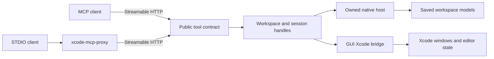

# Architecture

`xcode-mcp-proxy-server` exposes one public MCP tool contract over Streamable
HTTP. Workspace and device-session handles retain their execution context;
clients do not switch tool catalogs when moving between GUI and headless work.

## Request routing

`XcodeListWorkspaces` returns proxy identifiers for loaded headless models and
open GUI workspaces. A handle binds one native workspace or tab to its host.
Multiple tabs for the same path remain distinct. The public input is always
`workspaceIdentifier`; adapters supply the owning backend's selector.

`XcodeOpenWorkspace` uses the default headless host unless the caller explicitly
requests another host. Installation and process selection happen when a handle
is created. Existing handles retain their original route, including progress,
cancellation, queued work, and completion. GUI work does not silently fall back
to a saved model because that would change the operation's state and effects.

Native hosts own workspace contents, schemes, destinations, and test plans.
The handle registry owns references and resource lifetime; it does not copy that
business state. Device sessions similarly retain their creating host. A host
restart invalidates its native resources; clients obtain fresh handles instead
of replaying an operation against another host.

## Public and native catalogs

The proxy owns public tool names and schemas. Its adapters translate arguments
and results at the native boundary, including GUI tab selectors and device-key
spellings. Public tools remain callable without relying on a client to process
`notifications/tools/list_changed` after a routing change. An unavailable backend
operation returns a tool error.

Each backend retains its native catalog separately. `ToolsCatalogAuthority`
ties definitions to the exact connection and refresh that supplied them.
`ControlPlaneCoordinator` shares concurrent native loads while preserving each
caller's deadline and cancellation. A request captures its native definition;
a later catalog refresh cannot alter that request's response contract. A retired
connection cannot commit a late catalog as current.

## Lifecycle and failure

The runtime owns request correlation, progress, cancellation, and connection
recovery. Delivery-unknown mutations are not replayed. Replacement initialization
waits for the previous owned host to stop. Closing an MCP session releases its
handles and channels; it does not quit a GUI Xcode process.

Shutdown stops admission, cancels and drains owned request/event tasks, stops
backend connections, and closes owned native models and preview resources.
`close()`, `stop()`, and `shutdown()` are graceful completion boundaries;
deinitialization requests cancellation only.

## Ports and discovery

The server binds `localhost:8765` by default. `--listen`, `--host`, `--port`, and
`LISTEN` / `HOST` / `PORT` select another address. Endpoint discovery uses
`~/Library/Caches/XcodeMCPProxy/endpoint.json` unless overridden.

The STDIO adapter resolves explicit `--url`, `XCODE_MCP_PROXY_ENDPOINT`, the
discovery file, then `http://localhost:8765/mcp`. The Swift client's default
`.streamableHTTPProxyDiscovery()` reads the proxy discovery record and requires
a running server. Explicit standalone `.localBridge(.nativeHost(...))` starts
an owned headless host.

A discovery record is a URL hint. Only a connection and standard MCP initialize
handshake establish reachability. Discovery publication is part of server
startup; write failure unwinds acquired resources.

## Streamable HTTP contract

- Every request is checked by one Origin policy before route resolution, session creation, debug reset, or upstream I/O. This includes `/health`, `/debug/*`, MCP routes, and unknown routes.
- A missing `Origin` header is allowed for non-browser clients. When `Origin` is present it must be one valid HTTP(S) origin whose host and port match the actual listener policy; empty, multiple, `null`, malformed, and cross-origin values return `403`.
- `POST /mcp` requires `Content-Type: application/json` and `Accept` containing both `application/json` and `text/event-stream`.
- The server generates `MCP-Session-Id` on `initialize`; caller-provided session ids are ignored for initialize.
- After initialize, `POST`, `GET`, and `DELETE` require `MCP-Session-Id`. An explicit `MCP-Protocol-Version` must be valid, supported, and match the negotiated version.
- When `MCP-Protocol-Version` is omitted, the server uses the session's negotiated version. If no negotiated version exists, it evaluates the protocol-defined fallback `2025-03-26` and returns `400` when that version is unsupported.
- Missing session ids return `400`; unknown or terminated session ids return `404`.
- `DELETE /mcp` terminates the session; later requests with that session id return `404`.
- A client transport session with no in-flight HTTP request and no open SSE stream is retained for five minutes after its last client activity so that an interrupted SSE connection can reconnect. A one-minute sweep then terminates stale sessions and their buffered notifications; outbound server notifications do not extend this lifetime. Runtime-internal control-plane and health-probe sessions do not participate in transport expiry.
- HTTP connection, SSE connection, request, and response access events are debug telemetry, including expected protocol-level `4xx` responses. The response remains the client-visible error contract.
- Empty, singleton, and mixed JSON-RPC arrays return `400`; the internal executor and response router operate on typed single messages. An array response from an upstream is a protocol violation.
- Upstream `notifications/progress` is delivered only to the session that owns the active operation lease. It is dropped when no owner exists; globally scoped server notifications continue to fan out to initialized sessions.
- HTTP owns each session's bounded SSE notification buffer. On overflow it drops the oldest notification and emits at most one warning per 30 seconds per session. `dropped_notifications` is cumulative for that session, while the warning also reports the dropped delta and sanitized methods of the notifications actually evicted; notification payloads are never logged. Unhandled server notifications remain debug-level events.

## Native integration

The packaged `XcodeMCPNativeHost.app` loads the selected Xcode's frameworks
through ABIBridge and executes headless actions without GUI Xcode or Xcode
Service. The process owns its AppKit event loop, document controller, framework
values, and workspace resources. Apple's frameworks remain in the installed
Xcode and are not redistributed.

GUI execution uses Apple's `mcpbridge` for the requested running Xcode process.
A process identity includes its launch time so a reused PID cannot redirect work.
The optional Accessibility permission monitor is composed separately and has no
role in tool routing. See the [maintainer guide](maintainer-architecture.md) for
module boundaries, native corrections, signing, and verification.
